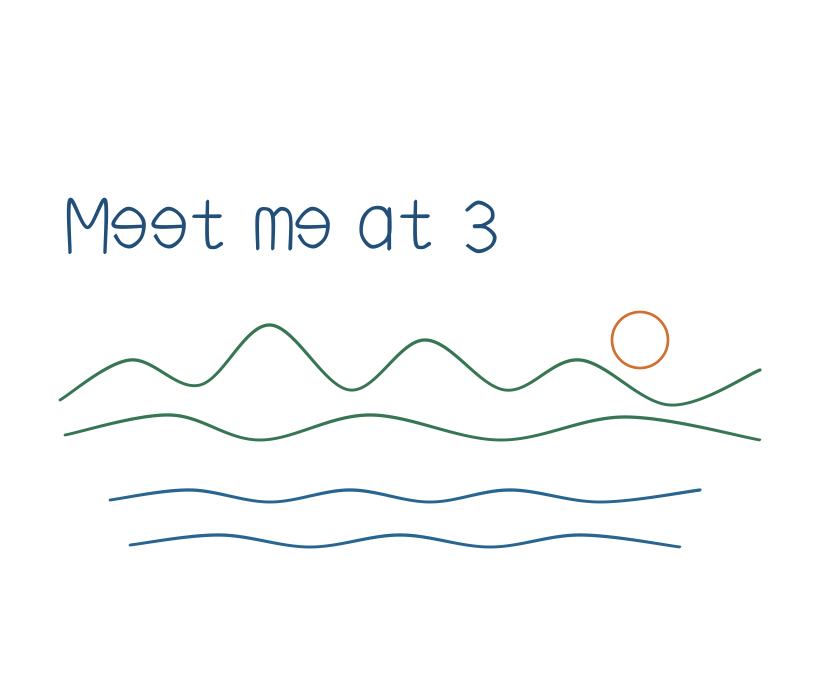

I tratti di penna restano inchiostro sulla pagina. Scrivi una breve nota, poi fai uno schizzo accanto. Usa **Seleziona** per spostare o ridimensionare un tratto, **Lazo** per prenderne alcuni insieme, e **Annulla tratto** per togliere l'ultimo segno.

Questa nota e questo schizzo sono stati disegnati con la penna. Sono tratti modificabili, non lettere digitate né un'immagine piatta.

Indietro: [Forme](../shapes/).

