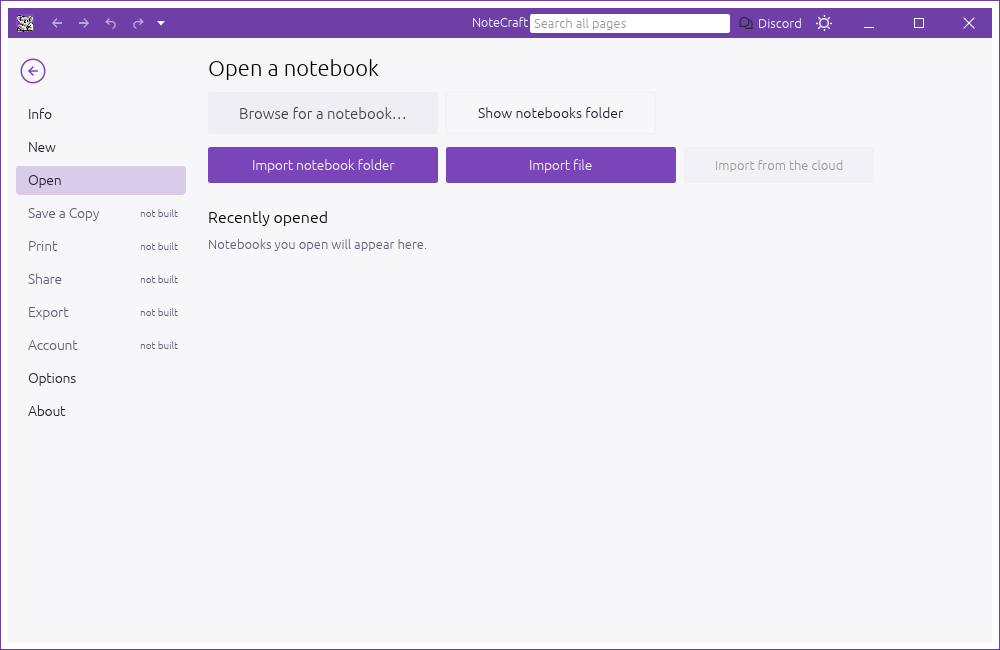
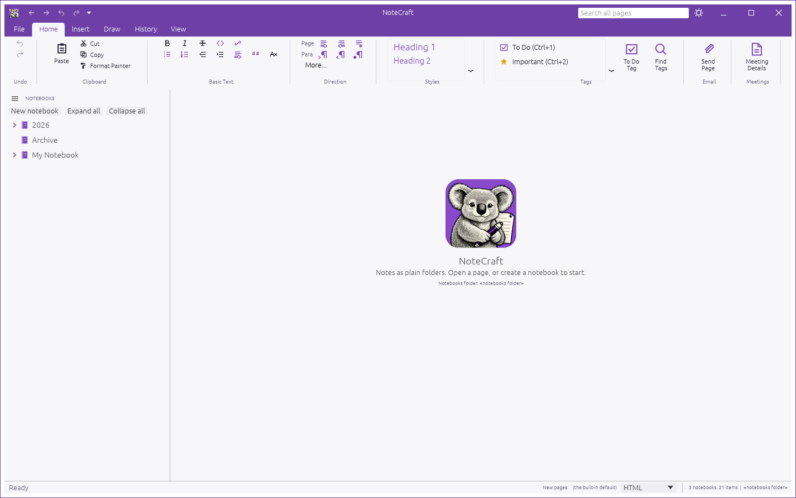
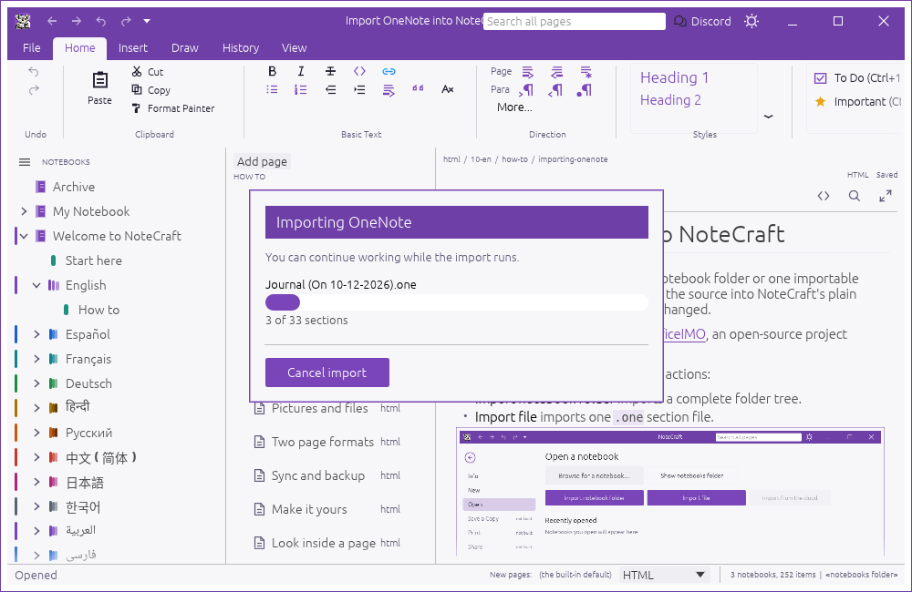

NoteCraft può importare una cartella di quaderno completa o un singolo file importabile. Il
ponte OfficeIMO converte l'origine nel formato di cartelle semplici di NoteCraft. L'origine
resta invariata.

La lettura di OneNote è fornita da [OfficeIMO](https://github.com/EvotecIT/OfficeIMO), un progetto open source distribuito con [licenza MIT](https://github.com/EvotecIT/OfficeIMO/blob/master/LICENSE).

In **File > Apri** usa le due azioni di importazione:

- **Importa cartella del quaderno** importa un intero albero di cartelle.
- **Importa file** importa un singolo file di sezione `.one`.

## Importa cartella del quaderno

Scegli **Importa cartella del quaderno** e seleziona una cartella come `2026`. Il nome della
cartella diventa il nome del quaderno. Le cartelle annidate diventano gruppi di sezioni e i file
`.one` diventano sezioni. Pagine e sottopagine mantengono nomi e gerarchia.

## Importa file

Scegli **Importa file** e seleziona un file `.one`. NoteCraft crea un quaderno con il nome del
file e ci mette dentro la sezione importata.

## Cosa succede durante l'importazione

NoteCraft crea la destinazione dentro la cartella dei quaderni configurata, apre il quaderno
importato dopo un'importazione riuscita e lo aggiunge agli Aperti di recente. I file OneNote
originali non vengono mai modificati. Una finestra di avanzamento mostra la sezione corrente e
permette di annullare in sicurezza.

Se esiste già un quaderno con lo stesso nome, NoteCraft evita di sovrascriverlo aggiungendo un
suffisso in stile Windows: `2026`, `2026 (1)`, `2026 (2)` e così via.

Le importazioni di cartelle scendono nelle cartelle annidate. Le cartelle diventano gruppi di
sezioni, i file `.one` diventano sezioni, e pagine e sottopagine mantengono nomi e gerarchia.

Mentre un'importazione è in corso, NoteCraft mostra una finestra di avanzamento con il tema
corrente, con la sezione attuale, il conteggio e un pulsante Annulla importazione.

Le sezioni cifrate o non supportate sono segnalate nel file `import-errors.txt` del quaderno
importato. Le sezioni leggibili si aprono comunque quando una cartella contiene un misto di file
leggibili e non supportati.
