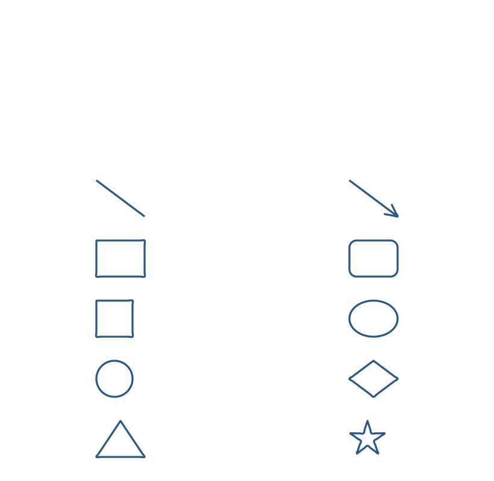

Scegli una forma nella scheda **Disegno**, poi trascina sulla pagina. Ogni forma è un tratto modificabile. Selezionala per spostarla o ridimensionarla, oppure usa **Annulla tratto** per rimuoverla.

Le dieci forme sono disposte nello stesso ordine a due colonne del gruppo **Forme**.

| Sinistra | Destra |
|---|---|
| Linea | Freccia |
| Rettangolo | Arrotondato |
| Quadrato | Ellisse |
| Cerchio | Rombo |
| Triangolo | Stella |

Avanti: [Scrittura a mano e disegno](../handwriting-and-drawing/).

