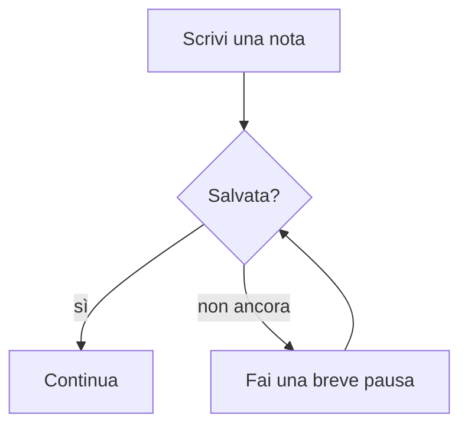
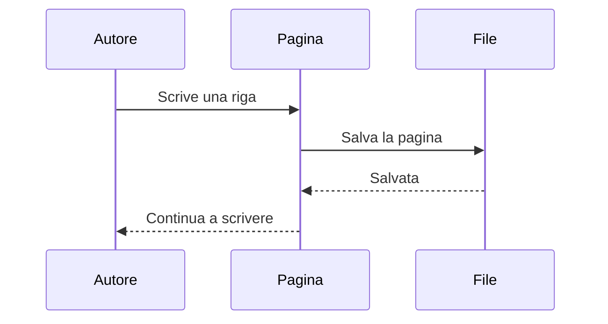
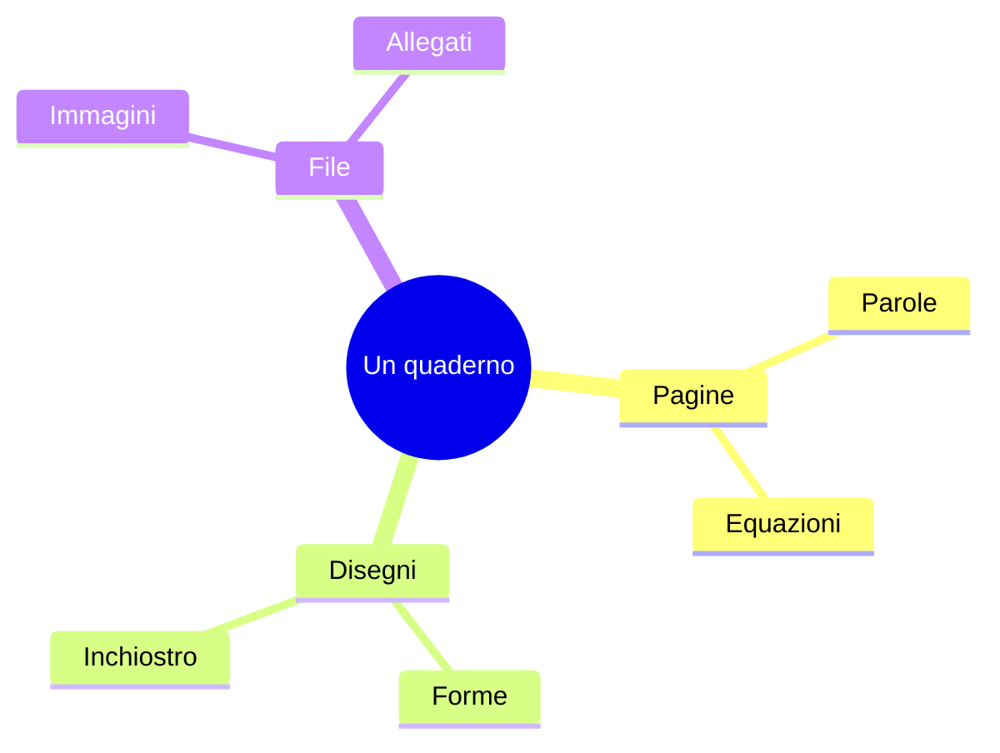
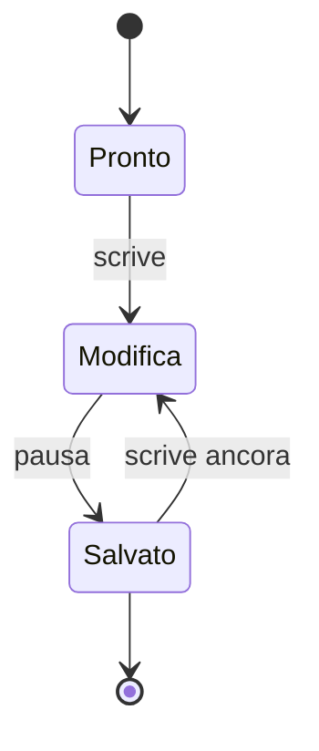
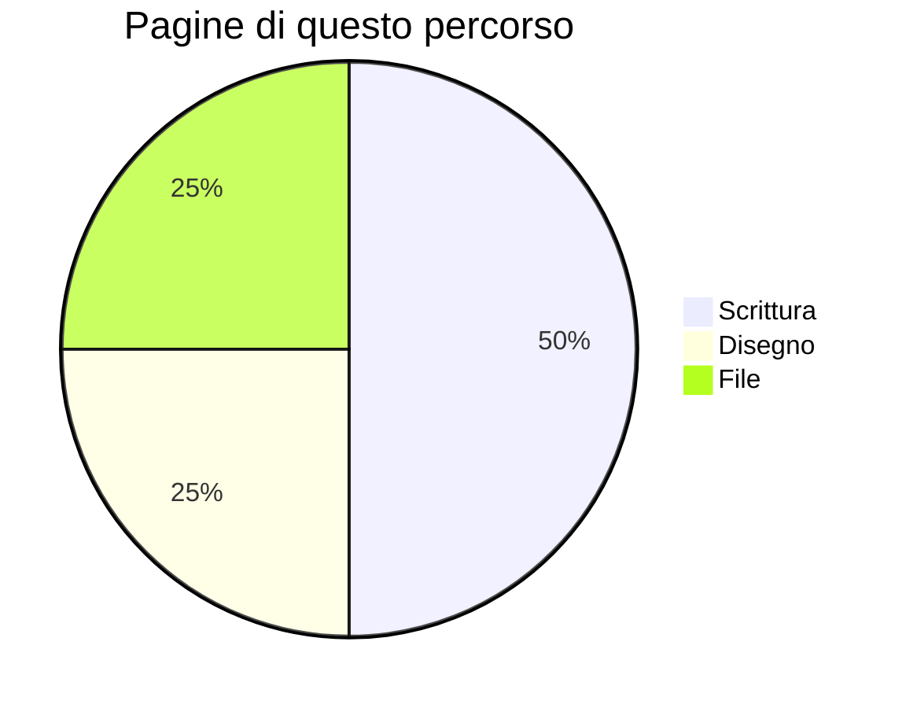

# Diagrammi Mermaid

Scrivi un diagramma come testo Mermaid in un blocco delimitato. NoteCraft disegna il blocco sulla
pagina nel tema corrente; apri il sorgente della pagina con **< >** per modificare il testo.

## Diagramma di flusso

## Sequenza

## Mappa mentale

## Diagramma di stato

## Diagramma a torta

Ogni blocco è un diagramma a sé. Il testo resta nel file della pagina, quindi si può cambiare o
copiare senza un editor di immagini.

Avanti: [Grafici, Vega e D3](../charts-vega-d3/).
