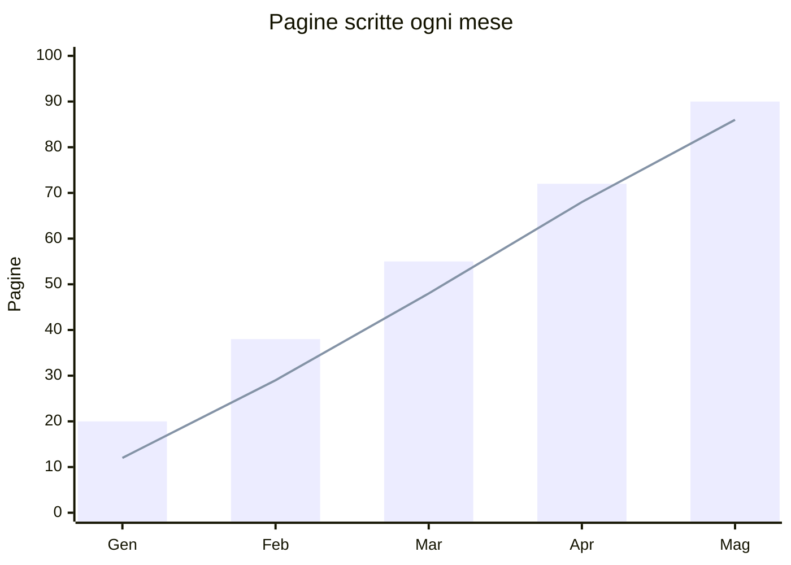
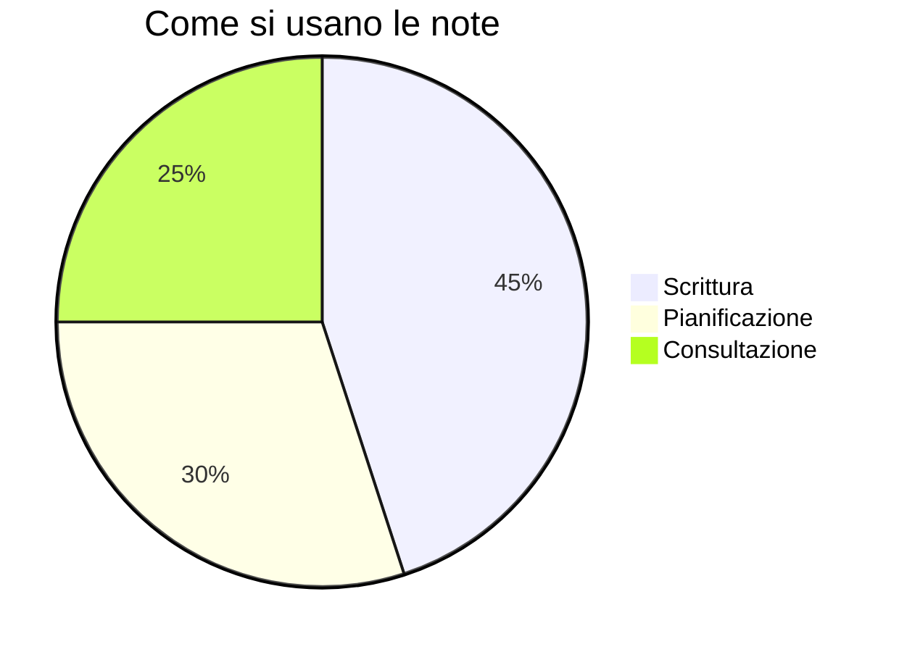
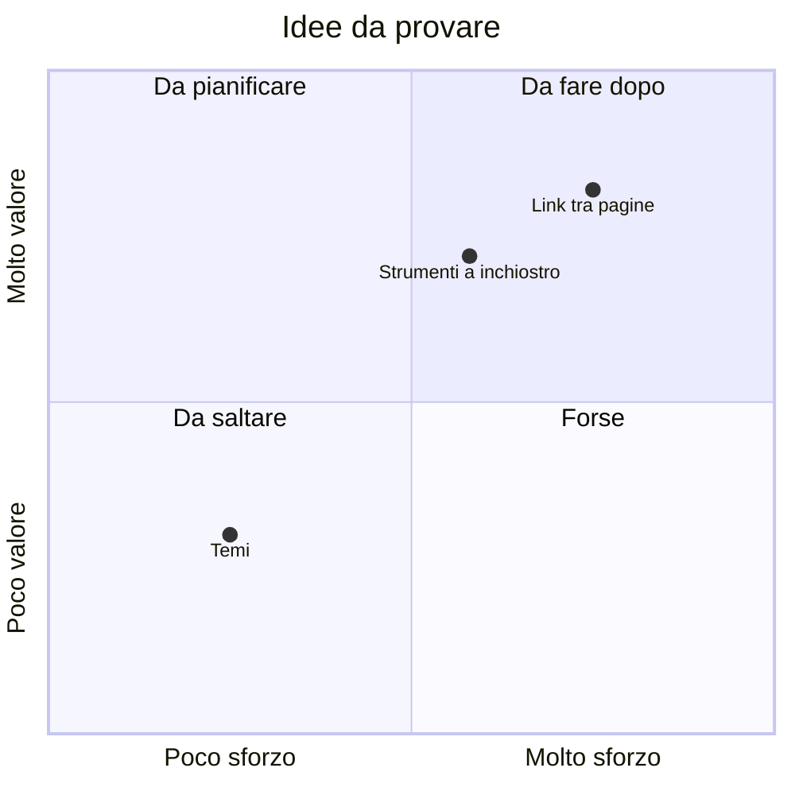
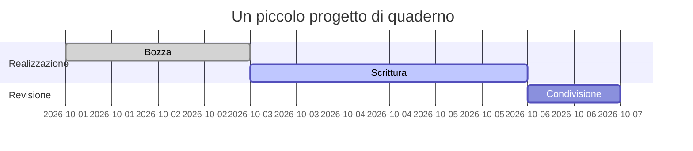

# Grafici, Vega e D3

NoteCraft disegna direttamente sulla pagina i blocchi di grafici Mermaid. Gli esempi qui sotto
sono grafici disegnati. Anche le specifiche Vega e i programmi D3 sono modi utili per descrivere
i grafici, ma per ora NoteCraft li conserva come codice: non li esegue né li disegna come grafici.

## Grafici disegnati

### Barre e una linea



### Una torta



### Un quadrante



### Un calendario



## Sorgente Vega: un grafico a barre

Questa specifica è mostrata come sorgente JSON, non ancora disegnata da NoteCraft.

```json
{
  "$schema": "https://vega.github.io/schema/vega-lite/v5.json",
  "data": {
    "values": [
      {"month": "Jan", "pages": 20},
      {"month": "Feb", "pages": 38},
      {"month": "Mar", "pages": 55}
    ]
  },
  "mark": "bar",
  "encoding": {
    "x": {"field": "month", "type": "ordinal"},
    "y": {"field": "pages", "type": "quantitative"}
  }
}
```

## Sorgente Vega: un grafico a linee

```json
{
  "$schema": "https://vega.github.io/schema/vega-lite/v5.json",
  "data": {
    "values": [
      {"month": "Jan", "pages": 12},
      {"month": "Feb", "pages": 29},
      {"month": "Mar", "pages": 48}
    ]
  },
  "mark": "line",
  "encoding": {
    "x": {"field": "month", "type": "ordinal"},
    "y": {"field": "pages", "type": "quantitative"}
  }
}
```

## Sorgente D3: un grafico a barre

Questo JavaScript è il codice sorgente di un grafico D3. NoteCraft mostra il codice ma non lo esegue.

```javascript
const data = [
  { month: "Jan", pages: 20 },
  { month: "Feb", pages: 38 },
  { month: "Mar", pages: 55 }
];

const svg = d3.select("svg")
  .attr("width", 400)
  .attr("height", 260);
const x = d3.scaleBand()
  .domain(data.map(d => d.month))
  .range([0, 360])
  .padding(0.15);
const y = d3.scaleLinear()
  .domain([0, d3.max(data, d => d.pages)])
  .range([220, 0]);

svg.selectAll("rect")
  .data(data)
  .join("rect")
  .attr("x", d => x(d.month))
  .attr("y", d => y(d.pages))
  .attr("width", x.bandwidth())
  .attr("height", d => 220 - y(d.pages));
```

## Sorgente D3: un grafico a linee

```javascript
const data = [
  { month: "Jan", pages: 12 },
  { month: "Feb", pages: 29 },
  { month: "Mar", pages: 48 }
];

const svg = d3.select("svg")
  .attr("width", 400)
  .attr("height", 260);
const x = d3.scalePoint()
  .domain(data.map(d => d.month))
  .range([20, 360]);
const y = d3.scaleLinear()
  .domain([0, d3.max(data, d => d.pages)])
  .range([220, 0]);
const line = d3.line()
  .x(d => x(d.month))
  .y(d => y(d.pages));

svg.append("path")
  .datum(data)
  .attr("fill", "none")
  .attr("stroke", "currentColor")
  .attr("d", line);
```

Usa i blocchi Mermaid per vedere i grafici nella pagina. Tieni gli esempi Vega e D3 come codice
finché NoteCraft non aggiungerà il supporto a quei formati.

Avanti: [Da destra a sinistra](../right-to-left/).
